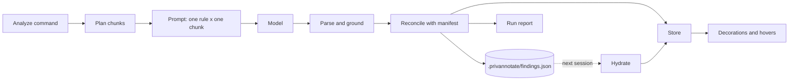

# PrivAnnotate architecture

PrivAnnotate reads the file open in the editor, asks a language model which *data practices*
it implements (collecting user data, sharing it with third parties, retention, security,
AI use, and so on), and shows the answers as highlighted lines that the user accepts or
rejects. Findings and decisions persist in a JSON manifest committed with the code.

This document explains how that works and where each piece lives. For usage, see the
[README](../README.md); for the detection framework itself, see
[privacy-detection-information-categories.md](privacy-detection-information-categories.md).

## The pipeline



1. **Plan.** The file is split into line windows ("chunks") small enough to fit the
   model's context next to one detection rule. Adjacent chunks overlap.
2. **Prompt.** Every chunk is paired with every rule. Each pair becomes one request, with
   a few in flight at a time.
3. **Parse and ground.** Each reply must be a JSON array of findings. Malformed entries are
   dropped, and a finding whose quoted code is not in the lines it claims loses a
   confidence level.
4. **Reconcile.** Fresh findings are matched to stored ones by a content fingerprint, so
   accept/reject decisions carry across runs and edits.
5. **Persist, paint, report.** The manifest is updated, the editor is repainted, and a
   run summary goes to the *PrivAnnotate* output channel.

On a later session the flow runs from the other end: the manifest is read, each stored
span is re-located in the current text ("hydrated"), and the result is painted.

## Source layout

| Folder | Responsibility | Main files |
| --- | --- | --- |
| `src/` | Activation, settings | `extension.ts`, `config.ts` |
| `src/commands/` | Everything registered as a command | `analyze.ts`, `decisions.ts` (accept/reject/undo), `view.ts` (toggles, report), `manifest.ts` (reset) |
| `src/analysis/` | Talking to the model | `chunking.ts`, `prompts.tsx`, `parseResponse.ts` |
| `src/rules/` | The detection rules (framework content) | `catalog.ts` |
| `src/findings/` | Finding data: types, identity, storage | `schema.ts`, `fingerprint.ts`, `reconcile.ts`, `manifest.ts`, `persistence.ts`, `store.ts` |
| `src/ui/` | What the user sees | `decorations.ts`, `hover.ts`, `report.ts` |
| `src/test/` | Mocha suites and the `vscode` stub | see [Testing](#testing) |

Dependencies point one way: `commands` → `analysis`/`findings`/`ui` → `rules`. Nothing in
`analysis` or `findings` imports from `ui`, which is what lets most of the logic run in
plain Node tests.

## Core concepts

### Detection rules

`src/rules/catalog.ts` defines one `PrivacyRule` per category: an ID (`FP-01` … `AI-08`), the
category enum name the model must return, a description, reasoning guidance, elicitation
questions, positive *and* negative worked examples, and the IDs of related rules. The eight
rules cover six OPP-115 categories, OPP-115's Do Not Track category adapted for code, and a
custom AI/ML category.

The catalog is the single source of truth for prompt content: prompts render its fields
directly, and the parser validates categories against its enum.

### Chunking

`planChunks` in `src/analysis/chunking.ts` sizes chunks by measuring, not guessing. It counts
the tokens of the whole file (with the `N| ` line prefixes the prompt adds). If that is over
budget it halves the range and recurses, so the number of token counts grows with the number
of chunks, not the number of lines. Each chunk after the first then extends backwards by
`chunkOverlapLines`, so a practice that spans a boundary appears whole in at least one chunk.
A fixed reserve (`INSTRUCTION_RESERVE_TOKENS`) leaves room for the rule and instructions.

### Prompts

`src/analysis/prompts.tsx` builds each request with
[`@vscode/prompt-tsx`](https://github.com/microsoft/vscode-prompt-tsx), in four parts:

| Part | Priority | Content |
| --- | --- | --- |
| Output contract | 100 | The JSON schema (`FINDING_JSON_SCHEMA`, shared with the parser) and formatting rules |
| Code | 95 | The chunk, numbered with 1-based line numbers, between `<<<CODE_INPUT>>>` markers |
| Prelude | 90 | Role, scope ("this one rule only"), grounding rules |
| Rule | 85 | The rule's full text and examples |

When the budget is tight, prompt-tsx drops lower-priority parts first, so the schema and the
code survive longest. The code part claims whatever space is left. If it still doesn't fit,
`longestFittingPrefix` binary-searches how many lines fit, and the analyze command refuses
to send a prompt that no longer contains any code. Instructions go in an assistant message
because the VS Code LM API has no system role.

### Parsing and grounding

`src/analysis/parseResponse.ts` never throws: a rule that returns garbage yields no findings
and doesn't affect the other seven. For each array element it:

1. validates the shape (`isRawFinding`),
2. drops inverted ranges and ranges outside the chunk, and clamps the rest,
3. **grounds** the excerpt: if its first line isn't in the claimed lines, confidence drops
   one level (it is not removed, since the model may have only reformatted real code),
4. overrides the category with the rule's own, keeps valid cross-references, and computes
   the fingerprint.

### Identity and reconciliation

A finding's **fingerprint** (`src/findings/fingerprint.ts`) is a SHA-256 prefix of its
category plus its excerpt with whitespace normalized. Line numbers are deliberately left
out. Moving or reindenting code keeps the fingerprint and therefore the user's decision;
changing the code produces a new finding.

`reconcile` in `src/findings/reconcile.ts` merges a run with the manifest. Location, evidence
and confidence come from the new run; status and history (`firstSeen`, `decidedAt`) come from
the manifest. It sorts results into *added*, *persisted*, *suppressed* (previously rejected),
*reopened* (previously resolved) and *resolved* (not seen this run). `mergeForStorage` keeps
the resolved ones, marked with `resolvedAt`, so the manifest is an annotate trail rather than
a cache.

`relocate` finds where a stored span sits in the current text by matching the excerpt's first
line and preferring the match nearest the old position. If no line matches, the span is
marked **stale**. `relocateAll` in `persistence.ts` relocates a whole document's findings
against a line index (`indexLines`) built once. It runs on load, and also after an Analyze
run during which the document was edited.

### The manifest

Each workspace folder gets its own `.privannotate/findings.json`, keyed by path relative to that
folder. `src/findings/manifest.ts` handles it:

- **Validated on read.** Malformed findings are dropped one at a time, and an unknown
  `version` means starting empty rather than misreading the file.
- **Deterministic on write.** Keys and findings are sorted so the file diffs cleanly.
- **One write at a time.** `ManifestStore` runs `update` and `reset` through a per-folder
  promise chain, so an accept/reject click during an analysis save can't lose either write.
- **Knows its own writes.** The store remembers what it last wrote. When the file watcher
  fires, `isInSync` compares that against disk, and only changes the extension didn't make
  (a git pull, a hand edit) trigger a reload.

`StoredFinding` is `PrivacyFinding` minus the runtime-only fields (`file`, `stale`).

### Editor UI

- **Store** (`src/findings/store.ts`): the loaded findings for each document URI. Commands
  change this, and decorations and hovers read from it.
- **Decorations** (`src/ui/decorations.ts`): one decoration type per status (orange =
  undecided, blue = accepted, grey = rejected). Overlapping findings merge into one highlight
  with a badge. `visibleFindings` is the single place that applies the two view toggles:
  *Toggle All Findings* (everything) and *Toggle Rejected Findings*.
- **Hovers** (`src/ui/hover.ts`): built only when the user hovers a line. They list every
  visible finding covering that line, with Accept / Reject / Undo `command:` links that carry
  `{ uri, fingerprint }`.
- **Decisions** (`src/commands/decisions.ts`): update the finding in memory, repaint right
  away, then save to the manifest.
- **Reset** (`src/commands/manifest.ts`): after a modal confirmation, deletes every folder's
  manifest and clears the store.
- **Report** (`src/ui/report.ts`): a diff against the previous run in the output channel,
  plus a one-line notification.

### Lifecycle

`activate` (on `onStartupFinished`) registers the commands and the hover provider,
publishes the context keys, and restores findings for visible editors. It then keeps them
current as editors open. `hydratedAt` records which document version each file's findings
were located against, so an unchanged file is only repainted while an edited one is
re-hydrated.

Analyze runs are limited to one per file (`tryBeginAnalysis`). A run records
`document.version` when it starts; if the file changed by the end, findings are
re-anchored before reconciling and the report says so.

## Settings

Read once per run from the `privAnnotate` section by `src/config.ts`, which type-checks and
clamps every value:

| Key | Default | Used by |
| --- | --- | --- |
| `model.vendor` / `model.family` | `copilot` / any | model selection in `analyze.ts` |
| `analysis.maxConcurrentRequests` | 3 (1–16) | `runWithConcurrency` |
| `analysis.chunkOverlapLines` | 20 (0–200) | `planChunks` |

Context keys `privAnnotate.findingsVisible` and `privAnnotate.rejectedVisible` mirror the toggles
for use in `when` clauses.

## Design decisions

- **One rule per request.** It costs more requests, but each rule gets the full context
  window, a failure affects only one category, and the model never has to juggle eight
  taxonomies at once.
- **Downgrade, don't delete.** Grounding lowers confidence instead of removing the finding;
  the user decides.
- **Content identity.** All persistence rests on fingerprints that ignore line numbers.
- **Nothing is silently forgotten.** Rejected and resolved findings stay in the manifest.
  Only an explicit, confirmed reset deletes it.
- **Treat files and settings as untrusted input.** The manifest and settings can be
  hand-edited, so both are validated on every read.
- **Paint first, save second.** Decisions repaint before the manifest write finishes.
- **Inject what's hard to fake.** `planChunks` takes a token counter, and reconciliation
  works on a `TextSource`, so most logic is testable without VS Code.

## Testing

```bash
npm run test:unit   # plain Node + mocha, with src/test/stub serving require('vscode')
npm test            # the same suites inside a real Extension Development Host
```

`src/test/stub/vscodeStub.ts` implements only the API surface the code uses, including an
in-memory file system and configuration. Its test helpers (`__setWorkspaceFolder`,
`__readFile`, `__setWarningResponse`, `__setConfiguration`) exist only in the stub, so
suites that need them skip themselves in the real host.

| Suite | Covers |
| --- | --- |
| `rules.test.ts` | Catalog integrity: categories, examples, cross-references |
| `chunking.test.ts` | Budgeting, splitting, coverage, overlap |
| `prompts.test.ts` | Prompt content, numbering, truncation, `longestFittingPrefix` |
| `parseResponse.test.ts` | JSON extraction and the validation/grounding steps |
| `findings.test.ts` | Fingerprints, reconcile, relocate, `indexLines`, manifest serialization |
| `persistence.test.ts` | `ManifestStore` reset and `isInSync`, the reset command, loading, `relocateAll` |
| `analyze.test.ts` | Bounded concurrency and the one-run-per-file guard |
| `ui.test.ts` | The store, toggle visibility rules, hover contents |
| `config.test.ts` | Settings parsing and clamping |

## Extending

**Add or change a rule.** Edit `PRIVACY_RULES` (and `CATEGORY_NAMES` for a new category) in
`src/rules/catalog.ts`, with at least one positive and one negative example.
`rules.test.ts` checks the invariants, including that there are exactly eight rules. A new
rule adds one request per chunk.

**Add a finding field.** Add it to `PrivacyFinding` (`src/findings/schema.ts`); `StoredFinding`
picks it up automatically unless it is runtime-only. Update `toStoredFinding` and
`isStoredFinding`, and if the model provides it, `FINDING_JSON_SCHEMA`, `isRawFinding` and
`toFinding`. A change to the on-disk shape should bump `MANIFEST_VERSION`.

**Use a different model.** Set `privAnnotate.model.vendor` and `privAnnotate.model.family`. No code
change is needed unless the vendor needs something other than `vscode.lm`.